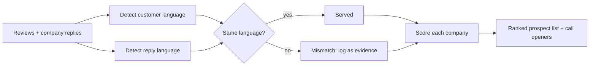

# review-language-signal

**Turn public review replies into a prospecting signal.** If a company answers its customers' reviews in a different language than they wrote in, it has a visible multilingual-support gap — and is a qualified prospect for anyone selling translation or localization.

## The story

As a BDR selling translation software at Unbabel, I was prospecting manually: slow, and blind to who actually needed us. I learned the Python I needed in a week and built a tool that checked one thing in prospects' public reviews: **did the company reply in the language the customer wrote in?** A mismatch meant a customer-experience failure anyone could see. Cold pitches became consultative calls that opened with evidence ("here is what your customers are experiencing"), and the tool earned my promotion to Growth Hacker.

This repo is a **generalized rebuild** of that idea, written from scratch. It runs on a synthetic dataset of fictional companies; it contains no code or data from any employer.

## How it works



1. **Detect** the language of each review and of the company's reply (texts under 20 characters are skipped as unreliable).
2. **Compare**: every reply in another language than the review counts as a mismatch, and the first two become evidence for the sales call.
3. **Score** each company on its mismatch rate, with a minimum of 5 classified replies so small samples don't create false prospects.
4. **Rank** into tiers: `qualified` (≥30% mismatches), `watch` (≥10%), `deprioritize`, or `insufficient-data`.

## Run it

```bash
pip install -r requirements.txt
python review_signal.py data/sample_reviews.csv --out prospects.csv
python -m pytest tests          # 6 tests
```

Output on the sample data:

```
tier              company                  mismatch  unserved languages
qualified         Nordlicht Outdoor            75%  de:5 nl:2 fr:2
qualified         Maison Verte Cosmetics       40%  es:3 en:1
watch             Bergström Living             17%  de:2
deprioritize      Costa Azul Travel             0%  -
deprioritize      Lumen Software                0%  -
insufficient-data Helix Mobile                 67%  fr:2
```

Helix Mobile has the second-highest mismatch rate but only 3 replies, so it isn't flagged yet. The full list, with evidence per company, is in [`data/example_prospects.csv`](data/example_prospects.csv).

## Input format

A CSV with one row per review: `company, domain, review_id, review_text, reply_text` (`review_date` and `rating` are optional). Leave `reply_text` empty when the company didn't answer.

**Where the reviews come from is up to you.** Use an official API or an export you are allowed to use, and respect each review site's terms of service. This repo deliberately ships without a scraper.

## Design choices

- **Evidence over scores.** A sales rep needs a sentence to open the call with, not a number. Each prospect comes with example reviews.
- **Minimum sample size.** One unanswered German review doesn't make a prospect. Companies with too few replies are kept but labeled.
- **Unserved languages, not just a rate.** Knowing *which* languages go unanswered tells sales which markets to pitch.

Part of my growth systems portfolio: [sara-beh8.github.io](https://sara-beh8.github.io)
